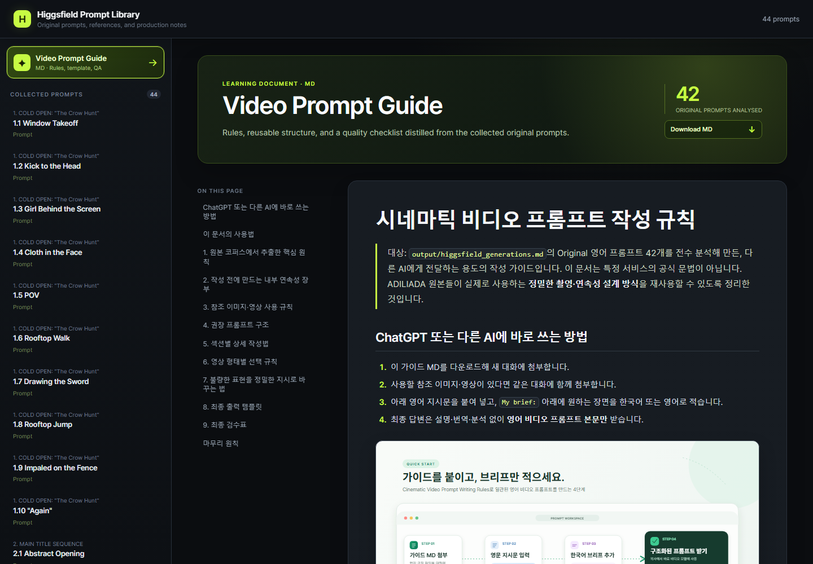
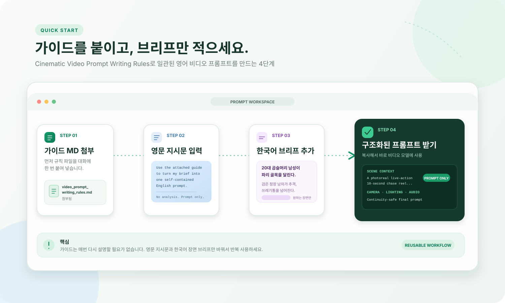

# Higgsfield Prompt Library

영상 제작 현장에서는 작업자마다 프롬프트 작성 방식과 디테일 수준이 달라 결과물의 품질과 일관성에 편차가 생길 수 있습니다. 이 문제를 줄이기 위해 Higgsfield가 공개한 `adiliada` 영화 프로젝트의 실제 영상 프롬프트를 수집·분석하고, 특정 모델에 종속되지 않고 여러 LLM에서 활용할 수 있는 Markdown 작성 가이드를 제작했습니다.

가이드 제작에 사용한 원본 프롬프트도 함께 크롤링해 원문, 한국어 번역, 영상, 참조 이미지, 제작 정보와 출처를 웹페이지에서 확인할 수 있도록 구성했습니다. 사용자는 완성된 규칙만 내려받는 데 그치지 않고, 각 규칙이 실제 프롬프트에서 어떻게 사용되었는지 사례를 비교하면서 직접 익힐 수 있습니다.

**웹사이트:** [tardis7732.github.io/higgsfield-prompt-library](https://tardis7732.github.io/higgsfield-prompt-library/)



## 제작 배경

실제 영상 제작에서는 같은 콘티와 레퍼런스를 사용하더라도 작업자의 경험과 프롬프트 작성 습관에 따라 결과가 크게 달라질 수 있습니다. 인물과 배경을 설명하는 수준에서 끝나는 프롬프트가 있는 반면, 카메라의 시작 위치와 이동 경로, 장면별 시간 배분, 오브젝트의 물리적 반응, 조명 변화와 연속성 잠금까지 명시하는 프롬프트도 있습니다. 이 차이는 생성 결과의 품질뿐 아니라 수정 횟수와 협업 효율에도 직접적인 영향을 줍니다.

이 프로젝트는 이러한 편차를 줄일 수 있는 실전 기준을 찾기 위해 Higgsfield가 공개한 `adiliada` 영화 프로젝트의 프롬프트를 사례 데이터로 삼았습니다. 공개 페이지에서 실제 프롬프트와 결과 영상, 참조 이미지, 제작 메타데이터와 출처를 함께 수집하고, 반복해서 등장하는 구조와 품질 관리 규칙을 비교했습니다.

분석 결과는 특정 영상 생성 모델의 문법에 한정하지 않고 ChatGPT, Gemini 등 여러 LLM에 첨부해 사용할 수 있는 Markdown 가이드로 정리했습니다. 또한 사용자가 완성된 규칙만 읽는 데 그치지 않고, 각 규칙이 실제 프롬프트 안에서 어떻게 적용됐는지 원문과 번역, 영상과 참조 자산을 함께 보며 학습할 수 있도록 웹 아카이브를 제작했습니다.

## 구현 흐름

1. 공개된 `adiliada` 프로젝트에서 실제 프롬프트, 영상, 썸네일, 참조 이미지, 제작 정보와 출처 URL을 수집했습니다.
2. 수집한 데이터를 브라우저에서 사용할 수 있는 JSON 구조로 정규화하고 원문과 한국어 번역, 관련 미디어의 연결 관계를 보존했습니다.
3. 42개 원본 프롬프트를 분석해 참조 범위, 첫 프레임, 카메라, 타이밍, 물리, 조명, 오디오와 최종 잠금 규칙을 범용 LLM용 Markdown 가이드로 체계화했습니다.
4. 44개 프롬프트를 폴더별로 탐색하고 원문·번역·영상·참조 자산·출처를 한 화면에서 비교할 수 있는 정적 웹페이지로 구성했습니다.

## 주요 기능

- Higgsfield가 공개한 `adiliada` 영화 프로젝트의 실제 영상 프롬프트 탐색
- 원본 영어 프롬프트와 한국어 번역을 나란히 비교
- 원본 영상, 썸네일, 참조 이미지와 출처 페이지 확인
- 프롬프트별 메타데이터와 제작 정보 열람
- 원문·번역문 개별 복사
- 42개 원본 프롬프트의 작성 패턴을 분석한 범용 LLM용 Markdown 가이드 제공
- 가이드 규칙과 실제 사용 사례를 같은 페이지에서 비교 학습
- 가이드 목차 탐색 및 Markdown 파일 다운로드
- 별도 빌드 과정 없이 GitHub Pages에서 정적 배포

## ChatGPT 또는 다른 AI에서 활용하기

웹페이지에는 사람을 위한 사용법과 예시를 표시하고, 다운로드 버튼은 사람용 안내를 제외한 GPT용 규칙 파일을 별도로 제공합니다.

1. [GPT용 비디오 프롬프트 규칙 MD](./downloads/video_prompt_writing_rules_for_gpt.md)를 다운로드합니다.
2. 새 대화에 가이드 MD와 사용할 참조 이미지·영상을 첨부합니다.
3. 아래 지시문을 붙여 넣고 `My brief:` 아래에 만들고 싶은 장면을 작성합니다.
4. AI가 설명이나 분석 없이 바로 사용할 수 있는 영어 비디오 프롬프트만 출력하도록 합니다.



```text
Use the attached "Cinematic Video Prompt Writing Rules" as the governing style guide.
Turn my brief and attached references into one self-contained English video-generation prompt.
Treat it as a continuity-safe shot plan, not a mood board.
Use uppercase English section headings. Follow only the sections needed for the scene.
Resolve reference scope, first-frame state, shot structure, camera, timing, physics,
lighting, audio, and final locks before writing.
Output only the final English prompt. Do not output workflow notes, patch logs,
analysis, translations, Hide, or unresolved reference tokens.

My brief:
20대 곱슬머리 남성이 밝은 오후 2시의 파리 거리에서 달린다. 검은 양복의 남성이
그를 뒤쫓는다. 10초 안에 그는 쓰레기통을 넘어뜨리고 행인과 어깨를 부딪히지만
멈추지 않고 계속 달린다.
```

참조 자료를 사용할 때는 각 자료의 적용 범위를 짧게 고정하는 것이 좋습니다.

```text
@Image 1: character face only
@Image 2: location and lighting only
@Video 1: camera timing for Shot 3 only
```

## 저장소 구성

```text
.
├─ index.html                         # 웹 인터페이스
├─ style.css                          # 화면 스타일
├─ app.js                             # 탐색, 렌더링, 복사, 가이드 뷰어
├─ config.js                          # 데이터 및 가이드 경로
├─ data/
│  └─ library.json                    # 브라우저용 프롬프트 라이브러리
├─ downloads/
│  ├─ video_prompt_writing_rules.md   # 웹페이지용 사용법과 작성 가이드
│  └─ video_prompt_writing_rules_for_gpt.md # GPT 첨부용 규칙
├─ assets/
│  ├─ prompt-guide-usage.svg          # 가이드 사용 흐름
│  └─ screenshots/                    # README용 실제 웹 화면
└─ .github/workflows/
   └─ deploy-pages.yml                # GitHub Pages 자동 배포
```

공개 저장소에는 웹 뷰어, 정리된 JSON, 다운로드용 가이드와 배포 설정만 포함합니다. 크롤러, 브라우저 프로필, 로컬 원본 서버, 수집 과정의 임시 파일은 포함하지 않습니다.

## 로컬 실행

브라우저에서 JSON과 Markdown을 `fetch`하므로 `index.html`을 직접 여는 대신 간단한 정적 서버를 사용합니다.

```bash
python -m http.server 8000
```

실행 후 [http://localhost:8000](http://localhost:8000)을 엽니다.

## GitHub Pages 배포

`main` 브랜치에 변경 사항을 푸시하면 `.github/workflows/deploy-pages.yml`이 정적 사이트 전체를 자동 배포합니다.

새 저장소에서 사용할 경우:

1. 저장소를 Public으로 생성합니다.
2. 이 프로젝트 파일을 저장소 루트에 올립니다.
3. **Settings → Pages → Source**에서 **GitHub Actions**를 선택합니다.
4. `main` 브랜치에 푸시하면 배포가 실행됩니다.

`Download GPT Rules MD` 버튼은 같은 저장소의 `downloads/video_prompt_writing_rules_for_gpt.md`를 직접 제공하므로 GitHub Pages와 일반 정적 호스팅에서 모두 동작합니다.
